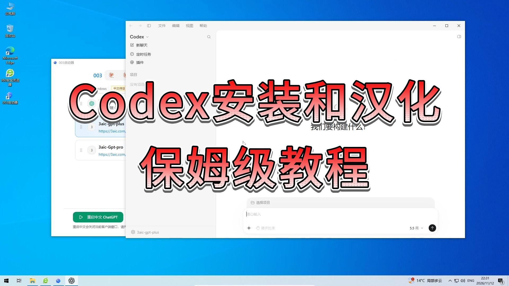

# Codex/ChatGPT 安装教程与使用指南官网下载

> **官方入口：[www.sz003.com/anzhuang](https://www.sz003.com/anzhuang)**
> Windows / macOS 都能装 · 桌面端、命令行、编辑器三种形态分开讲

## 仓库介绍

本仓库内容整理自 [Codex中文站](https://www.sz003.com/)，已收录 11 篇，每篇都保留官网原文链接：可以在这里直接读，也可以 `git clone` 到本地检索。

Codex 是 OpenAI 推出的 AI 编程智能体，有三种形态：装在电脑上的桌面客户端、在终端里跑的 Codex CLI、以及挂在 IDE 里的插件。三种形态的安装方式、能碰的文件范围、适用的活都不一样，混着讲最容易装错。本仓库按「怎么装、怎么用、怎么排查」三块整理，收录 Codex 中文站已经发布过的安装与使用类文章，每篇都能点回官网看原文。

## 视频演示

## 安装入口

所有安装包统一放在官网安装页，按自己的系统和芯片选，一个链接直达：

### ➡️ [点击进入 Codex 安装下载页（www.sz003.com/anzhuang）](https://www.sz003.com/anzhuang)

| 系统 | 装法 | 说明 |
| --- | --- | --- |
| Windows | 桌面客户端 | 微软商店版与传统安装包两种，装不上先分清自己装的是哪种 |
| macOS | 桌面客户端 | Intel 芯片与 Apple 芯片分开，按芯片下载 |
| Windows / macOS | Codex CLI | 终端命令行工具，四种官方安装方式，npm 那条路已不再推荐 |
| VS Code | IDE 插件 | 在编辑器里开对话，适合不想切窗口的人 |

装之前先确认一件事：桌面客户端和 CLI 是两条独立的路，装一个不等于装了另一个。CLI 装完要在终端里敲 `codex` 能起来才算通；桌面端装完要能看到登录界面。两个都装也不会冲突，但配置分开存，别混着改。

安装步骤、登录、以及装完之后要改哪几项配置，仓库里 11 篇按顺序排好了，从最新往下看即可。

## 主要特点

- 三种形态分开讲：桌面客户端、CLI 命令行、IDE 插件，各讲各的装法和适用场景。
- Windows 和 macOS 都覆盖，微软商店版与传统安装包的区别单独交代。
- 装完之后的配置逐项写：config.toml 常用项、AGENTS.md 怎么写、权限三档怎么选。
- Skills、MCP、Hooks、Plugins 四个扩展机制各有专文，标清彼此区别。
- 报错按现象归类：连不上、装不上、跑不动、一直重连，给出排查顺序。
- 每篇保留官网原文链接，可在线阅读，也可 git clone 到本地检索。

## 常见问题

**装完敲 codex 提示找不到命令？** 九成是 PATH 没生效。关掉终端重开一次；还是找不到，说明装到了用户目录之外，回去看安装那一步的默认路径有没有改过。

**微软商店版装不上怎么办？** 商店版对系统版本和区域有要求，报错码不同原因不同。仓库里《Codex 常见报错》那篇按报错顺序列了排查路径，先看它再动手重装。

**桌面端和 CLI 要都装吗？** 不必须。桌面端适合长任务和看结果，CLI 适合在项目目录里直接改文件。只用一种也能干活，两个都装不冲突。

**装完能直接改我的项目文件吗？** 默认有沙盒与审批机制，要放行才会动文件。权限三档怎么选，仓库里有专文。

## 文章目录（11 篇）

- 2026-09-13 · [Codex 安装和登录：四条入口怎么选，装完怎么确认](https://www.sz003.com/jiaocheng/2678) · [仓库内阅读](docs/2678-Codex安装和登录：四条入口怎么选，装完怎么确认.md)
- 2026-09-13 · [Codex 画 PPT 实测：一上午干完一天的活，两条路怎么选](https://www.sz003.com/jiaocheng/2624) · [仓库内阅读](docs/2624-Codex画PPT实测：一上午干完一天的活，两条路怎么选.md)
- 2026-09-12 · [Codex 一直重连 1/5？一句话让它自己修好代理](https://www.sz003.com/jiaocheng/2623) · [仓库内阅读](docs/2623-Codex一直重连15？一句话让它自己修好代理.md)
- 2026-09-12 · [用不上最先进的 Codex？先别急着说自己不行](https://www.sz003.com/jiaocheng/2622) · [仓库内阅读](docs/2622-用不上最先进的Codex？先别急着说自己不行.md)
- 2026-09-12 · [ChatGPT 5.6 的模型选择：Sol、Astra、Terra 都是什么](https://www.laoshoucun.com/chatgptdt/3060) · [仓库内阅读](docs/3060-ChatGPT5.6的模型选择：Sol、Astra、Terra都是什么.md)
- 2026-09-12 · [ChatGPT 的三个入口 Chat、Work、Code 怎么分工](https://www.laoshoucun.com/chatgptdt/3059) · [仓库内阅读](docs/3059-ChatGPT的三个入口Chat、Work、Code怎么分工.md)
- 2026-09-12 · [Codex 学习提问模板：学新东西先搭阶梯再啃 20% 重点](https://www.sz003.com/jiaocheng/2621) · [仓库内阅读](docs/2621-Codex学习提问模板：学新东西先搭阶梯再啃20重点.md)
- 2026-09-09 · [Codex 该装哪些 Skill：新手第一批按基础/提效/业务三层挑](https://www.sz003.com/jiaocheng/2619) · [仓库内阅读](docs/2619-Codex该装哪些Skill：新手第一批按基础提效业务三层挑.md)
- 2026-09-03 · [Codex 和 DeepSeek harness 怎么选](https://www.sz003.com/jiaocheng/2614) · [仓库内阅读](docs/2614-Codex和DeepSeekharness怎么选.md)
- 2026-09-02 · [Codex 做游戏，这 10 个 Agent Skill 够你搭一支开发团队](https://www.sz003.com/chajian/2607) · [仓库内阅读](docs/2607-Codex做游戏，这10个AgentSkill够你搭一支开发团队.md)
- 2026-08-26 · [Codex总犯同样的错？搭好这套工作区架构，让它越用越聪明](https://www.laoshoucun.com/jiaocheng/2623) · [仓库内阅读](docs/2623-Codex总犯同样的错？搭好这套工作区架构，让它越用越聪明.md)

---

**官方入口：[Codex安装](https://www.sz003.com/anzhuang)**

© [Codex中文站](https://www.sz003.com/) · 本仓库为官网内容镜像，文章版权归原作者所有。
